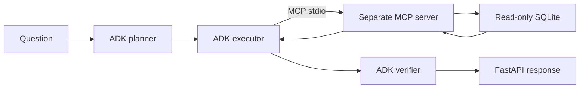

# Local Commerce Analyst with Google ADK and MCP

A local-first, tool-using commerce analytics demo. A Google ADK sequential workflow runs a planner, an MCP-backed analytics executor, and a verifier. The executor connects over MCP stdio to a separate Python process. The server exposes only parameterized, read-only aggregate tools over a seeded SQLite fixture; it never accepts caller-supplied SQL or Python source.

## What is implemented

- **Google ADK runtime:** a real `SequentialAgent` with three `LlmAgent` steps (`analytics_planner`, `mcp_analytics_executor`, `analytics_verifier`).
- **MCP:** a real stdio MCP server and client, with tool discovery and tool calls tested using the official MCP Python SDK.
- **Constrained data access:** two tools, schema metadata and a fixed set of commerce metrics. Metric/group/filter values are validated; SQL query structure is application-authored and filter values use bound parameters.
- **API and UI:** FastAPI exposes health, schema, deterministic metric, and configured-agent endpoints. Streamlit is a separate API client.
- **Local model support:** LiteLLM through ADK can route to an Ollama model. There is no API key requirement for a local Ollama instance. No model is bundled or downloaded automatically.
- **Seeded test data:** `data/create_db.py` generates the synthetic fixture. Native Python integer values are bound to SQLite to avoid NumPy scalar adaptation as binary blobs.

## Setup

Python 3.11 is supported. Create the fixture and install the project dependencies:

```powershell
python -m venv .venv
.\.venv\Scripts\Activate.ps1
python -m pip install -r requirements-dev.txt
python data/create_db.py
python -m pytest -q
```

Run the deterministic API and UI without configuring a model:

```powershell
uvicorn api.app:app --reload
```

In another terminal:

```powershell
streamlit run streamlit_app/app.py
```

`POST /api/metrics` works without an LLM and is useful for testing supported aggregation behavior. `POST /api/analyze` returns HTTP 503 until a model is configured; it does not fall back to the previous keyword heuristic.

## Optional local Ollama model

Install and start Ollama separately, then pull a tool-capable model that fits your hardware. Model compatibility and quality vary, so run the evaluation cases before making quality claims. Configure:

```powershell
$env:ANALYST_MODEL = "ollama_chat/qwen3:4b"
$env:OLLAMA_BASE_URL = "http://localhost:11434"
uvicorn api.app:app --reload
```

For Docker Compose, copy `.env.example` to `.env`. Compose points the container at the host Ollama server. On Docker Desktop this uses `host.docker.internal`; the host Ollama service must be running and reachable.

Hosted models can be configured with an ADK-supported model name and the provider's credential set in the environment. Do not commit secrets. The model path is optional and deliberately kept separate from tests that validate the MCP boundary.

## Evaluation and limits

```powershell
python scripts/run_benchmark.py
```

This reports a small **tool regression check** that cross-checks several aggregate outputs against independently written SQL on the generated synthetic fixture. It is not an LLM benchmark and says nothing about natural-language intent accuracy, factual response quality, or production-scale throughput. The current test suite covers ADK graph construction, API validation, metric semantics, parameter rejection, SQLite read-only mode, and a real MCP stdio round trip. A full LLM evaluation remains pending until we select and run a model against labeled questions.

The analytics server intentionally cannot answer arbitrary SQL questions. Extend it by adding a narrowly scoped, parameterized tool and independent expected-result tests. Do not replace this with model-generated SQL execution. The bounded pilot below adds operator authentication and resource controls; tenant isolation and per-user/gateway quotas remain unimplemented.

## Architecture

### Bounded serving pilot

`APP_ENV=production` requires `ANALYST_API_KEY` (32+ characters); clients send
`X-API-Key`. The Streamlit server reads the same key from its environment. Requests
are bounded to 64 KiB, with two analyses/process, eight LLM calls/run, 128 events,
bounded answer output and a 60-second deadline. Overload returns 429; timeout 504.
Provider cancellation is best effort and cannot guarantee cancellation of billed work.
Run one worker and add external TLS/access controls and gateway quotas before remote use.

The MCP subprocess no longer inherits provider credentials. Responses report model,
elapsed time and provider token counts rather than an invented currency cost.
`/ready` requires model configuration and readable storage but does not probe paid
provider connectivity. Compose binds to loopback ports 8040/8540; the image runs as
a non-root user. Configure hosted provider credentials outside Git and verify billing
before a small call. Live LLM quality and telemetry activation remain unmeasured.



## Interview framing

Describe this as a local-first ADK/MCP prototype with deliberately constrained data access. Explain that MCP transport, tool contracts, aggregate semantics, and API validation are tested, while model answer quality has not yet been measured. Discuss how you would add a labeled semantic benchmark, compare local/hosted models, trace tool calls, and add tenant controls and per-user quotas before exposing it to users.

## Release verification and operations

The 22 November 2026 local verification passed **32 tests** and repository lint.
The API image passed non-root, network-isolated serving and actual MCP stdio checks. The independent aggregate regression passed 4/4 cases; no live LLM quality result is claimed.

See the standalone [operations guide](docs/OPERATIONS.md) for configuration,
failure handling, recovery and rollout limits. Cross-project reports and replay tools
live in the separate [portfolio guide](https://github.com/sachin2967/ml-portfolio).
Hosted CI and cloud deployment are separate checks; a local pass does not imply either.
