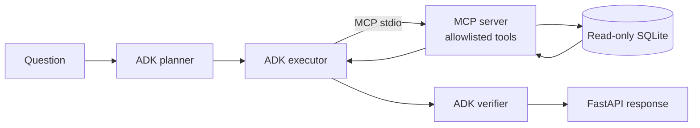

# Commerce Analyst: Google ADK + MCP

[](https://github.com/sachin2967/google-adk-multi-agent-analyst/actions/workflows/ci.yml)


A local-first, tool-using analytics agent. A Google ADK `SequentialAgent` runs a
planner, an MCP-backed executor and a verifier. The executor talks over MCP stdio to a
separate Python process that exposes only parameterized, read-only aggregate tools over
a seeded SQLite fixture. The model never supplies SQL or Python.

> **Scope.** This is a prototype on a **synthetic** database. CI exercises the agent
> workflow with a scripted model, so **live LLM answer quality has not been measured**.

## Highlights

- **Real ADK and MCP:** three `LlmAgent` steps (`analytics_planner`,
  `mcp_analytics_executor`, `analytics_verifier`) and a real stdio MCP server/client
  with tool discovery and calls, tested with the official MCP Python SDK.
- **Constrained data access:** two tools, schema metadata and a fixed set of metrics
  (`revenue`, `orders`, `average_review`, `average_delivery_days`) grouped by `none`,
  `category`, `state`, `month` or `status`. Inputs are validated against allowlists;
  query structure is application-authored and filter values are bound parameters.
- **No code execution:** caller-supplied SQL or Python is never accepted or run.
- **Bounded serving:** operator API key in production, 64 KiB request bodies, two
  concurrent analyses per process, eight LLM calls per run, 128 events, capped answer
  size and a 60 s deadline (overload returns 429, timeout 504).
- **No silent fallback:** `POST /api/analyze` returns 503 until a model is configured.
- **Local or hosted models:** Ollama through LiteLLM, or any ADK-supported model.

## Evaluation

| Check | Result | What it shows |
| --- | --- | --- |
| Test suite | Ruff lint and format plus pytest | ADK graph, API validation, metric semantics, parameter rejection, read-only SQLite, MCP stdio round trip, service limits |
| Tool regression (`scripts/run_benchmark.py`) | 4 of 4 pass | MCP aggregates match independently written SQL on the synthetic fixture |
| Live LLM answer quality | **Not yet run live** | Provider evaluation is pending |

The 4 cases are delivered revenue by category, order counts by status, overall average
review and order counts by state. They validate the data tools, not natural-language
understanding, and say nothing about production scale. See
[docs/EVALUATION.md](docs/EVALUATION.md).

### Frozen questions and offline preflight

The [frozen set](data/analyst_questions_v1.json) contains 12 authored
questions about the seeded synthetic database. Supported cases use separately
authored SQL to compute the expected result. The deterministic contract receives
oracle tool arguments and matched SQL on **8 of 8** supported cases.
The unsupported questions are reserved for live refusal checks.

Single-agent and multi-agent answer quality, latency, and token use are
**not yet run live**. The offline preflight measures the tool contract.

```bash
python data/create_db.py
python scripts/evaluate_live.py --split all --max-cases 12
```

See the [offline preflight report](evaluation/analyst_preflight.json).

## Architecture



Details in [docs/ARCHITECTURE.md](docs/ARCHITECTURE.md).

## Quickstart

Requires Python 3.11.

```bash
git clone https://github.com/sachin2967/google-adk-multi-agent-analyst.git
cd google-adk-multi-agent-analyst
python -m venv .venv && source .venv/bin/activate   # Windows: .\.venv\Scripts\Activate.ps1
make setup data test
make api          # http://127.0.0.1:8040/docs
make dashboard    # Streamlit client on :8540
```

PowerShell equivalent without `make`:

```powershell
python -m venv .venv; .\.venv\Scripts\Activate.ps1
python -m pip install -r requirements-dev.txt
python data/create_db.py
python -m pytest -q
uvicorn api.app:app --host 127.0.0.1 --port 8040
```

`POST /api/metrics` works with no model:

```bash
curl -s -X POST http://127.0.0.1:8040/api/metrics -H 'Content-Type: application/json' \
  -d '{"metric":"revenue","group_by":"category","limit":5}'
```

### Enable the agent endpoint

Run a tool-capable model separately, then set the model before starting the API:

```bash
export ANALYST_MODEL="ollama_chat/qwen3:4b"   # example; quality varies by model
export OLLAMA_BASE_URL="http://localhost:11434"
make api
```

Hosted models need an ADK-supported model ID and the provider credential in the
environment (never in Git). With Docker Compose, copy `.env.example` to `.env`; the
container reaches the host Ollama server. No model is bundled.

## API

| Route | Purpose |
| --- | --- |
| `GET /live` | Process liveness |
| `GET /ready`, `/health` | Configuration and storage checks (provider connectivity is not probed) |
| `GET /api/schema` | Analytics schema description |
| `POST /api/metrics` | Deterministic allowlisted aggregation, no LLM |
| `POST /api/analyze` | Run the ADK workflow; 503 without a model, 429 when busy, 504 on timeout |

## Production-style settings

`APP_ENV=production` requires `ANALYST_API_KEY` (32+ characters); clients send
`X-API-Key` and the Streamlit server reads the key from its environment. The MCP
subprocess does not inherit provider credentials. Responses report model, elapsed time
and provider token counts, not an invented currency cost. Run one worker, bind to
loopback and add TLS, access control and gateway quotas before remote use. See
[docs/OPERATIONS.md](docs/OPERATIONS.md).

## Repository layout

| Path | Responsibility |
| --- | --- |
| `src/agents/` | ADK sequential workflow and the bounded run service |
| `src/tools/mcp_tools.py` | MCP server and allowlisted metric tools |
| `src/sandbox/executor.py` | Fixed dataframe operation registry (no code execution) |
| `src/evaluation/benchmark.py` | Independent-SQL tool regression |
| `api/` | FastAPI app and request boundary (auth, size limits) |
| `streamlit_app/` | Dashboard that calls the API |
| `data/create_db.py` | Seeded synthetic SQLite fixture (500 customers, 50 products, 1,200 orders) |
| `scripts/run_benchmark.py` | Runs the tool regression |
| `tests/` | API, workflow, tool contract, and evaluation tests |
| `docs/` | Architecture, evaluation, operations |

## Limitations

- Synthetic data; results say nothing about a real business.
- No live-model evaluation, so answer quality, latency and cost per question are unknown.
- The server cannot answer arbitrary SQL questions by design. Extend it with a narrow,
  parameterized tool plus an independent expected-result test, never model-generated SQL.
- No tenant isolation or per-user quotas; the API key is an operator key, not user identity.
- Provider cancellation is best effort and cannot guarantee that billed work stops.

## Roadmap

Run the frozen questions against a configured provider and compare single-agent
and multi-agent quality, latency, and reported tokens. The question set and
trace collection are in place.

## License

MIT. Cross-project context lives in the [portfolio guide](https://github.com/sachin2967/ml-portfolio).
