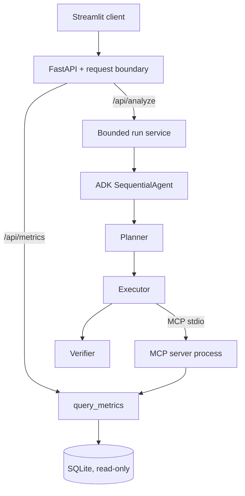

# Architecture

## Components

- **Request boundary** (`api/boundary.py`): enforces `X-API-Key` when configured
  (required in production), bounds bodies to 64 KiB and returns correlation-safe errors.
- **Run service** (`src/agents/service.py`): two concurrent runs per process, at most
  eight LLM calls per run, 128 events, 16,000 characters of answers and a 60 s deadline.
  Overload maps to 429 and timeout to 504.
- **ADK workflow** (`src/agents/adk_system.py`): a `SequentialAgent` of planner,
  executor and verifier. The executor's only tools come from the MCP server.
- **MCP server** (`src/tools/mcp_tools.py`): separate stdio process exposing
  `get_analytics_schema` and `analyze_commerce`. It receives no provider credentials.
- **Data** (`data/create_db.py`): seeded synthetic SQLite (seed 42), opened read-only.

## Why constrained tools instead of text-to-SQL

Arbitrary generated SQL or Python is hard to bound safely. Here the model chooses
among allowlisted metrics, groupings and filters; the SQL text is written by the
application and filter values are bound parameters. Invalid metrics, groupings and
limits (1 to 100) are rejected before any query. The cost is expressiveness: new
questions need a new reviewed tool and an independent expected-result test.

## Failure behavior

| Condition | Response |
| --- | --- |
| No `ANALYST_MODEL` | 503 on `/api/analyze`; `/ready` reports not ready |
| Missing or wrong key (production) | 401 |
| Too many concurrent analyses | 429 with `Retry-After` |
| Run exceeds deadline | 504 |
| Output over bound | Rejected rather than truncated silently |
